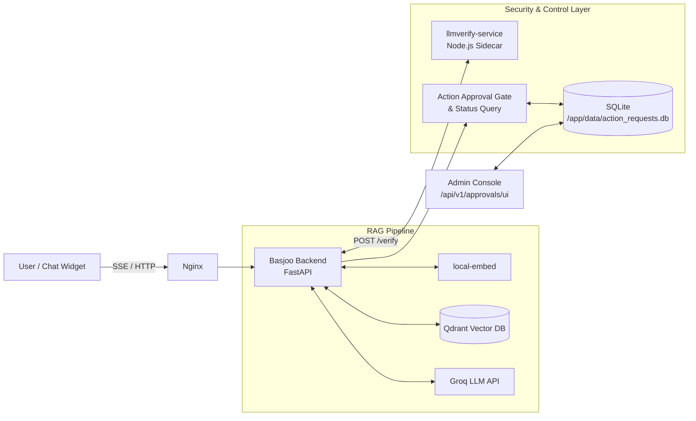

> 🌐 Language: **English** | [繁體中文](./README.zh-TW.md)

# 🛡️ Controllable AI Customer Service Agent (Basjoo + LLMVerify)

A controllable AI customer service system featuring **RAG Knowledge Base Q&A**, **Runtime Security Guardrails**, **Human-in-the-Loop Action Approval Gate**, and **Security Audit Logging**.

Built as a containerized extension on top of [Basjoo](https://github.com/basjoo/basjoo), this project addresses the three primary risks of deploying LLM customer support in production: **PII Leakage**, **Prompt Injection Attacks**, and **Unauthorized High-Risk Actions (Order Cancellation / Refunds)**.

---

## ✨ Key Features

### 1. RAG Knowledge Base & Streaming Chat (Core)
* Powered by **FastAPI + Qdrant Vector DB + Local Multilingual Embeddings (`local-embed`) + Groq LLM**.
* Supports real-time SSE streaming in the embedded chat widget with strict knowledge-base grounding and low-hallucination boundaries.
* **Bilingual Support (EN / ZH)**: Defaults to English and automatically adapts responses, guardrail badges, and approval status messages to the user's language.

### 2. Option A: Runtime Guardrails & Audit Logging
* Containerized Node.js security sidecar (**`llmverify-service`**) integrated into `docker-compose.yml` via internal Docker networking (`http://llmverify:3100/verify`).
* **Pass (`pass`)**: Normal queries pass through with a verification badge.
* **Bidirectional PII Redaction (`redact`)**: Automatically masks Malaysian IC numbers, phone numbers, and email addresses across both user inputs and AI outputs.
* **Prompt Injection Blocking (`block`)**: Detects and blocks English/Chinese system prompt overrides, developer mode, and jailbreak attempts.
* **Persistent Audit Logs**: Every verification decision (action, risk level, matched flags, input snippet, timestamp) is persisted to SQLite.

### 3. Option B: High-Risk Action Approval Gate (Human-in-the-Loop)
* **High-Risk Intent Interception**: Detects `cancel_order` and `refund` intents, extracts the order ID, and creates a `pending` approval request instead of letting the AI execute autonomously.
* **Bilingual Dual-Tab Admin Console (`/api/v1/approvals/ui`)**:
  * **Action Approvals Tab**: Admins can **Approve (`APPROVED`)** or **Reject (`REJECTED`)** requests with custom reviewer notes.
  * **Security Audit Logs Tab**: Live summary cards (`Total`, `pass`, `redact`, `block`) and detailed interception logs.
  * Includes a one-click **`🌐 EN / 繁體中文`** UI language toggle (defaults to English).
* **Self-Service Status Query**: Users can query their request progress directly in the chat widget (e.g., `Check status #1` or by Order ID) to retrieve the latest status and reviewer note from SQLite.

### 4. Automated End-to-End Regression Suite (`test_guardrails.py`)
* Includes **10 automated test cases** covering Option A (`pass`, MY IC/phone redaction, email redaction, EN/ZH injection blocking), Option B (`cancel_order`/`refund` creation, admin decision API, user status query), and Audit API verification.

---

## 🏗️ System Architecture



---

## 🚀 Quick Start (Docker Compose)

### 1. Environment Setup
Copy the environment template and configure your LLM API key (e.g., Groq):
```bash
cp .env.example .env
```

### 2. Build & Start All Services
```bash
docker compose --profile prod up -d --build
```

### 3. Access Endpoints
* **Customer Support Widget Demo**: `http://localhost:8080/demo.html`
* **Security Audit & Approval Console**: `http://localhost/api/v1/approvals/ui`

---

## 🧪 Run Automated Security Regression Tests

Copy the test script into the backend container and execute (expected: `10/10 PASSED`):

```bash
docker cp test_guardrails.py basjoo-backend:/tmp/test_guardrails.py
docker exec -e PYTHONPATH=/app -e PYTHONIOENCODING=utf-8 basjoo-backend python /tmp/test_guardrails.py
```

### Test Coverage
| # | Module | Scenario | Expected Result |
|---|--------|----------|-----------------|
| 01 | Option A | Standard KB Q&A | `pass` |
| 02 | Option A | User input with MY IC / Phone | `redact` (masked) |
| 03 | Option A | AI output containing Email | `redact` (masked) |
| 04 | Option A | Chinese Prompt Injection | `block` |
| 05 | Option A | English Prompt Injection / Jailbreak | `block` |
| 06 | Option B | Request to cancel order (`cancel_order`) | Creates `pending` request |
| 07 | Option B | Request for refund (`refund`) | Creates `pending` request |
| 08 | Option B | Admin Approve / Reject API | Updates status to `approved` / `rejected` |
| 09 | Option B | User status query by ID / Order ID | Returns latest status & reviewer note |
| 10 | Audit | Security Audit Logs API | Returns stats & log entries |

---

## 📁 Key Added & Modified Files

```text
├── docker-compose.yml              # Integrates basjoo-llmverify into basjoo-network
├── llmverify-service/              # Node.js runtime guardrails sidecar (Dockerfile + server.js)
├── backend/
│   ├── main.py                     # Mounts /api/v1/approvals router
│   └── api/v1/
│       ├── endpoints.py            # Connects LLMVerify, audit logging, approval gate & status query
│       └── approvals.py            # SQLite persistence, approval/audit APIs & bilingual Admin UI
└── test_guardrails.py              # 10-case end-to-end automated regression test suite
```

---

## ⚖️ Design Trade-offs

* **Sidecar Microservice Decoupling**: Isolating guardrails inside `llmverify-service` decouples security rule updates from the core FastAPI app, while a `try/except` fallback ensures sidecar downtime never breaks core chat availability.
* **Lightweight Persistence (SQLite)**: Storing approval requests and audit logs in `/app/data/action_requests.db` (mounted volume) keeps operational overhead near zero for prototyping while remaining easy to migrate to PostgreSQL.
* **Deterministic Rules + LLM Division of Labor**: High-risk action gating and status lookups rely on deterministic patterns and direct DB queries rather than LLM judgment, preventing unauthorized execution or status hallucinations.
