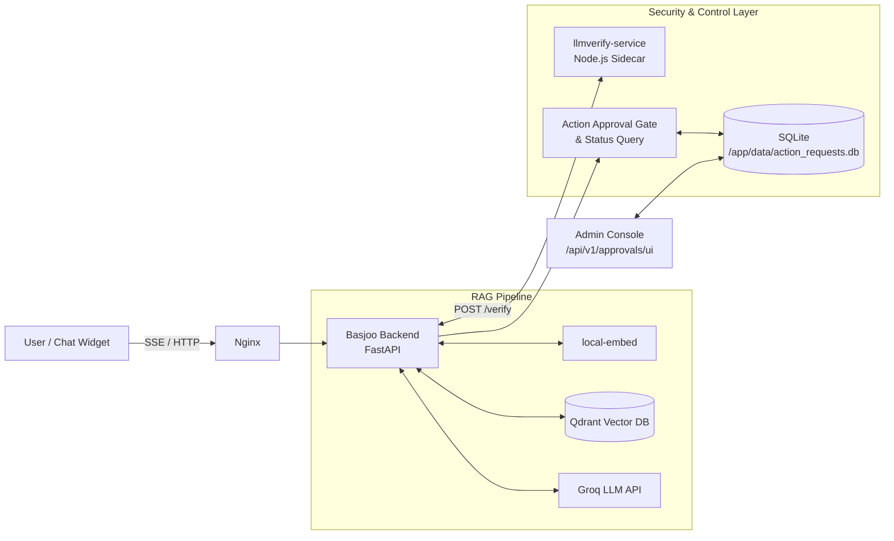

> 🌐 Language: [English](./README.md) | **繁體中文**

# 🛡️ Controllable AI Customer Service Agent (Basjoo + LLMVerify)

一套具備 **RAG 知識庫問答**、**運行時安全防護（Runtime Guardrails）**、**高風險動作人工審批門（Human-in-the-Loop）** 與 **安全審計日誌** 的可控 AI 客服系統。

本專案基於開源客服框架 [Basjoo](https://github.com/basjoo/basjoo) 進行二次開發與容器化整合，目標是解決企業導入 LLM 客服時最核心的三個痛點：**個資外洩（PII）**、**提示詞注入攻擊（Prompt Injection）** 與 **AI 越權執行高風險操作（取消訂單／退款）**。

---

## ✨ 核心功能亮點

### 1. RAG 知識庫與串流客服（Core）
* 整合 **FastAPI + Qdrant 向量資料庫 + 本地多語系嵌入模型（local-embed）+ Groq LLM**。
* 支援前端嵌入式對話氣泡（Widget）串流輸出（SSE），並於知識庫範圍外維持低幻覺與拒答邊界。

### 2. Option A：運行時安全防護與審計（Runtime Guardrails）
* 將獨立的 Node.js 防護側車服務 **llmverify-service** 容器化並納入 docker-compose.yml（內網通訊 http://llmverify:3100/verify）。
* **正常放行（pass）**：一般知識庫問答加上 [🛡️ 防護層：驗證通過] 狀態標記。
* **雙向 PII 脫敏（redact）**：自動偵測並遮罩馬來西亞身分證號（IC）、手機號碼與 Email（輸入端與 AI 輸出端皆生效）。
* **中英文提示詞注入攔截（block）**：偵測系統指令覆寫、開發者模式、Jailbreak 與 System Prompt 套取行為，直接阻斷輸出。
* **安全審計日誌（Audit Log）**：每次驗證結果（動作、風險等級、命中規則 Flags、輸入摘要與時間）持久化寫入 SQLite。

### 3. Option B：高風險動作審批門（Human-in-the-Loop）
* **高風險意圖攔截**：自動偵測 cancel_order（取消訂單）與 refund（申請退款）意圖並擷取訂單編號，建立 pending 待審單（不允許 AI 直接越權執行）。
* **雙分頁管理控制台（/api/v1/approvals/ui）**：
  * **高風險動作審批分頁**：管理員可一鍵執行 **核准（APPROVED）** 或 **拒絕（REJECTED）** 並填寫審批備註。
  * **安全審計日誌分頁**：即時統計總驗證次數、pass / redact / block 分佈卡片與完整攔截明細。
* **用戶自助查詢進度**：用戶可在 Widget 直接輸入「查詢 #1 的審批進度」或訂單編號，系統即時從 SQLite 撈取最新審批結果與備註回傳。

### 4. 自動化端到端回歸測試（test_guardrails.py）
* 內建 **10 項自動化測試案例**，涵蓋 Option A（放行、大馬 IC/手機脫敏、Email 脫敏、中英文注入攔截）、Option B（取消訂單／退款建單、管理員 API 核准／拒絕、用戶狀態查詢）與審計 API 驗證，支援一鍵回歸驗收。

---

## 🏗️ 系統架構圖



---

## 🚀 快速啟動（Docker Compose）

### 1. 環境設定
複製環境變數範本並填入對應的 LLM API Key（如 Groq）：
```bash
cp .env.example .env
```

### 2. 一鍵建置並啟動所有服務（含 llmverify-service）
```bash
docker compose --profile prod up -d --build
```

### 3. 訪問入口
* **前端客服 Widget 測試頁**：http://localhost:8080/demo.html
* **安全審計與高風險動作控制台**：http://localhost/api/v1/approvals/ui

---

## 🧪 執行自動化安全回歸測試

將測試腳本複製進後端容器並執行（預期結果 10/10 PASSED）：

```bash
docker cp test_guardrails.py basjoo-backend:/tmp/test_guardrails.py
docker exec -e PYTHONPATH=/app -e PYTHONIOENCODING=utf-8 basjoo-backend python /tmp/test_guardrails.py
```

### 測試涵蓋項目
| # | 模組 | 測試場景 | 預期結果 |
|---|------|----------|----------|
| 01 | Option A | 正常知識庫問答 | pass |
| 02 | Option A | 輸入端含大馬 IC / 手機號碼 | redact（遮罩脫敏） |
| 03 | Option A | AI 輸出端含 Email | redact（遮罩脫敏） |
| 04 | Option A | 中文提示詞注入攻擊 | block（攔截） |
| 05 | Option A | 英文提示詞注入 / Jailbreak | block（攔截） |
| 06 | Option B | 請求取消訂單（cancel_order） | 建立 pending 審批單 |
| 07 | Option B | 請求申請退款（refund） | 建立 pending 審批單 |
| 08 | Option B | 管理員 API 核准與拒絕 | 狀態更新為 approved / rejected |
| 09 | Option B | 用戶依編號或訂單號查詢進度 | 回傳最新狀態與管理員備註 |
| 10 | Audit | 查詢安全審計日誌 API | 回傳統計數據與紀錄清單 |

---

## 📁 主要新增與修改檔案

```text
├── docker-compose.yml              # 整合 basjoo-llmverify 容器並加入 basjoo-network
├── llmverify-service/              # Node.js 運行時安全防護微服務（Dockerfile + server.js）
├── backend/
│   ├── main.py                     # 掛載 /api/v1/approvals 路由
│   └── api/v1/
│       ├── endpoints.py            # 串接 LLMVerify、審計日誌寫入、高風險攔截與進度查詢
│       └── approvals.py            # SQLite 持久化、審批/審計 API 與雙分頁管理控制台 UI
└── test_guardrails.py              # 10 項端到端自動化回歸測試腳本
```

---

## ⚖️ 設計取捨（Design Trade-offs）

* **Sidecar 微服務解耦**：將安全防護獨立為 llmverify-service 容器，使規則更新與主後端解耦；同時在後端加入 try/except 降級機制，確保側車異常時不致拖垮核心客服可用性。
* **輕量持久化（SQLite）**：原型階段直接將審批單與安全審計日誌寫入掛載卷 /app/data/action_requests.db，零額外資料庫維運成本，容器重啟資料不遺失，後續可無縫遷移至 PostgreSQL。
* **確定性規則＋LLM 分工**：高風險動作攔截與審批進度查詢採用確定性正則與資料庫查詢，避免純 LLM 判斷產生不可控的誤放行或狀態幻覺。
